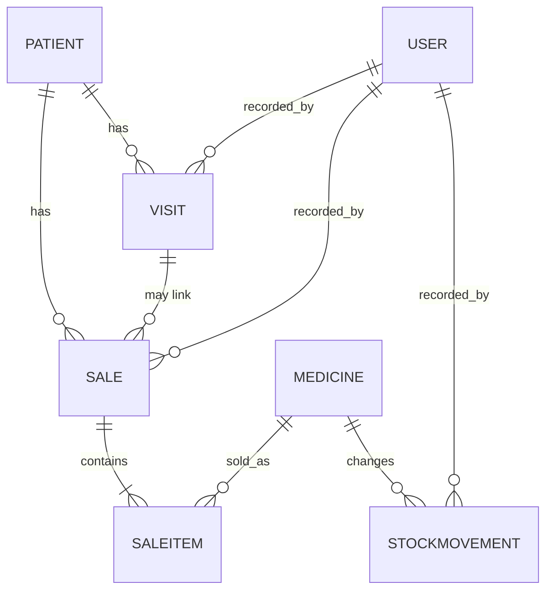

# Clinic System (Lupane State University)

A web-based Clinic/Pharmacy Management System built with Python and Django.

Patients, medicine stock, consultation fees, medicine sales, payments (cash, EcoCash, bank), reports and
role-based access, all in one application. Staff do their daily work in the app itself. The Django admin is
only for the administrator.

## Run it on a new laptop (Windows PowerShell)

Install Python 3.12 or newer first (tick "Add Python to PATH"), then in the folder that contains `manage.py`:

```powershell
python -m venv venv
venv\Scripts\activate
pip install -r requirements.txt

python make_env.py          # creates the .env file with a fresh secret key (local settings)

python manage.py migrate
python manage.py setup_roles
python manage.py createsuperuser
python manage.py runserver
```

Open http://127.0.0.1:8000/ and sign in.

Optional fake data for testing (never use real patient data in a test system):

```powershell
python manage.py seed_demo --with-users --password "choose-a-long-password"
```

This adds sample medicines, patients, a visit and a sale, plus the users `pharm1` (Pharmacist) and `recep1` (Receptionist).

## Roles

| | Admin | Pharmacist | Receptionist |
|---|---|---|---|
| Dashboard stock overview | yes | yes | yes |
| Money earned (dashboard) | yes | no | no |
| Medicines: view | yes | yes | yes |
| Medicines: add / edit | yes | yes | no |
| Stock in / adjust, Stock Management, Expiry Alerts | yes | yes | no |
| Patients: view | yes | yes | yes |
| Patients: register / edit | yes | no | yes |
| New Visit (consultation fee) | yes | no | yes |
| New Sale (medicines) | yes | yes | no |
| Reports | all five periods | daily and weekly | none |
| Record a payment in USD or ZiG | yes | yes | yes |
| Exchange rate: view, fetch, set | yes | no | no |
| Delete anything | yes (admin site) | no | no |

Create staff accounts at `/admin/` (Users, Add). Put each person in exactly one group. Tick **Staff status** only
for people who need the Administration area. Pharmacists and receptionists do not need it.
Run `python manage.py setup_roles` again after changing the rules in `accounts/management/commands/setup_roles.py`.

## Two currencies: USD and ZiG

Prices, fees and the 0.50 minimum are in **US dollars**. When a visit or sale is recorded, staff choose what the
patient **paid in** (USD or ZiG). The system then saves the exchange rate that applied at that moment, so old
records never change when the rate moves.

- **USD balance**: money received in US dollars.
- **ZiG balance**: money received in ZiG.
- **Total (USD value)**: everything added together, each ZiG payment counted at its own locked-in rate.
- The dashboard, the report sheets, the patient history and the receipts all show these. The current rate is shown
  at the top of every page and turns amber when it is more than 3 days old.

**Keeping the rate up to date** (Admin, sidebar: Billing, Exchange Rate):

```powershell
python manage.py update_rate                 # fetch the latest rate automatically
python manage.py update_rate --rate 26.15    # or set it by hand
python manage.py update_rate --force         # accept a rate that jumped more than 25%
```

- With `ALLRATES_API_KEY` set in `.env` (free key from allratestoday.com), it reads the **RBZ official interbank
  middle rate**. Without a key, or if that feed is down, it falls back to the market rate from open.er-api.com
  (keyless, updates once a day, please credit exchangerate-api.com).
- It refuses rates outside 1 to 500 ZiG per USD, and automatic updates that jump more than 25% from the last rate.
  Check those and enter them by hand if they are real.
- Until a rate exists, only US dollars can be recorded.
- Schedule `python manage.py update_rate` every weekday morning (Windows Task Scheduler on your own PC, or a cron
  job on the host). The RBZ publishes its rate on business days, so weekends reuse Friday's rate.

## Business rules (enforced in the model, the forms and, for fees, the database)

- A contraceptive is never issued to a male patient or to a patient above `CONTRACEPTIVE_MAX_AGE` (settings.py, currently 49: confirm the real limit with the clinic).
- No payment under 0.50 USD (`MIN_PAYMENT` in `billing/rules.py`). For a sale, the minimum applies to the whole sale total.
- Stock only changes through stock movements (stock in, sale, adjustment). Movements and finished sales cannot be edited. Corrections are new adjustments.
- You cannot sell more than is in stock, and you cannot sell an expired medicine.
- A sale locks in the price at the time of sale. Later price changes do not alter old sales.
- EcoCash and bank payments need a reference.
- Stock level colours: red at or below the low level, green at or above the high level, yellow in between (set per medicine).
- Medicines expiring within about six months are flagged on the dashboard and on Expiry Alerts.

## Folder map

```
manage.py
requirements.txt, .env.example, .gitignore
config/            settings.py (reads .env), urls.py, testutils.py
templates/         base.html (layout), form_page.html, partials/field.html
accounts/          login page, logo, setup_roles and seed_demo commands
patients/          Patient model, forms, views, templates
pharmacy/          Medicine and StockMovement, medicines pages, inventory pages
billing/           Visit, Sale, SaleItem, payment rules, New Visit and New Sale pages, receipt
reports/           dashboard, daily to yearly sheets, search, sidebar permissions
```

## Tests

```powershell
$env:DJANGO_DEBUG="True"
python manage.py test
```

The suite checks the stock colours, stock movements, the contraceptive rule, the minimum payment (including the
database constraint), overselling, expired medicines, EcoCash references, the report periods and totals, and what
each role can open.

## Data model



## Going live

See `ROADMAP.md`, Phase 8. The settings already read the secret key, debug switch, allowed hosts and database from
environment variables, and switch to PostgreSQL when `DATABASE_URL` is set.
